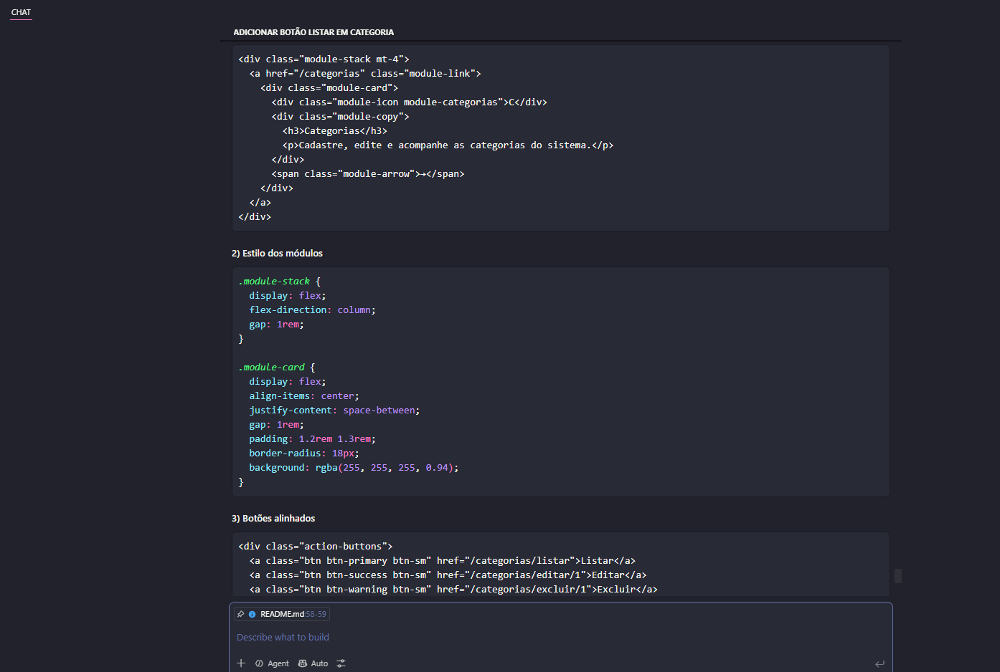

# Atividade-Nodejs-Navegacao

# Sistema de Cadastro

## Nome do Projeto
Sistema de Cadastro

## Integrantes
- SATORU NAKAZAWA 2ºDS

## Objetivo
O projeto tem como objetivo gerenciar categorias, clientes, fornecedores e produtos em uma interface administrativa moderna, organizada e responsiva, facilitando o cadastro e a organização das informações.

## Tecnologias Utilizadas
- Node.js
- Express
- EJS
- Bootstrap 5
- HTML5
- CSS3
- JavaScript

## Funcionalidades
- Cadastro de categorias
- Cadastro de clientes
- Cadastro de fornecedores
- Cadastro de produtos
- Edição e exclusão de registros
- Listagem de registros por módulo
- Navegação entre módulos
- Interface visual modernizada e responsiva

## Prompt Utilizado
> "Melhore o design do sistema de cadastro para deixá-lo mais moderno, profissional e responsivo. Quero uma interface mais limpa, com melhor organização dos elementos, botões mais refinados, cards mais elegantes e um rodapé mais sofisticado. Também quero que os módulos fiquem em sequência vertical, com navegação clara e mais visualmente agradável."

## Uso da Inteligência Artificial
A IA foi utilizada como ferramenta de apoio para sugerir melhorias de design e organização visual do sistema. Ela ajudou a propor uma identidade visual mais moderna, melhorias na estrutura dos módulos, refinamento dos formulários e ajustes de layout para melhorar a experiência do usuário.

## Alterações Sugeridas pela IA
- Organização vertical dos módulos da página inicial
- Cards mais modernos e com melhor destaque visual
- Ajuste de espaçamento e alinhamento dos elementos
- Padronização dos formulários de cadastro
- Melhor aparência dos botões e ações de navegação
- Reestilização do rodapé e do cabeçalho
- Criação de uma identidade visual mais profissional com logo moderna

## Alterações Implementadas pelo Grupo
- Ajuste do layout da página inicial para exibir os módulos em sequência vertical
- Padronização visual dos formulários de cadastro de categorias, clientes, fornecedores e produtos
- Melhor organização dos botões de ação em cada módulo
- Controle do espaçamento para evitar áreas vazias no rodapé
- Revisão manual do alinhamento e detalhamento visual dos elementos
- Implementação da logo do sistema e ajustes finos de design
- Ajustes finais de responsividade e organização visual do projeto

## Prints da Conversa com a IA

## Antes da Reestilização

## Depois da Reestilização

## Link da Aplicação
https://atividade-nodejs-navegacao-4.onrender.com/

## Link do Repositório
(https://github.com/satorumateus02-hash/Atividade-Nodejs-Navegacao.git)

# Evidências da conversa com a IA

## Resumo da conversa
A IA sugeriu melhorias em vários pontos do sistema, principalmente relacionadas ao visual e à usabilidade:

1. Organização visual da página inicial
   - empilhamento vertical dos módulos
   - cards com melhor hierarquia visual
   - espaçamento mais consistente

2. Melhor modalidade de navegação
   - botões mais modernos
   - ações de Listar, Editar e Excluir alinhadas
   - cards clicáveis e claros

3. Padronização dos formulários
   - layouts com cabeçalho visual mais forte
   - campos com visual uniforme
   - aparência mais profissional e consistente

4. Reestilização do rodapé
   - rodapé com identidade visual mais bem definida
   - melhor separação de conteúdo e alinhamento
   - elementos com melhor leitura e aparência corporativa

5. Criação de identidade visual
   - destaque do nome do sistema
   - logo moderna com monograma
   - uso de cores e padrão visual alinhados ao projeto

## Sugestões implementadas
- página inicial com módulos empilhados e clicáveis
- cards de módulos com melhor espaçamento e organização
- botões alinhados e padronizados nos módulos de cadastro/listagem
- rodapé mais refinado com layout profissional
- logo moderna e alinhada com a identidade visual do sistema
- formulários de cadastro com visual consistente e mais elegante

## Alterações feitas manualmente pelos integrantes
As alterações abaixo foram ajustadas manualmente depois das sugestões da IA, com revisão da equipe:

- refinamento do alinhamento dos elementos visuais
- correção de espaçamento e margens entre blocos
- adaptação da navegação para manter consistência entre páginas
- ajuste final do footer para maior legibilidade
- revisão da aparência geral para manter o sistema funcional e profissional
- personalização do código para evitar problemas de layout e manter o sistema estável

## Observação
Este arquivo funciona como evidência textual da conversa e das melhorias. A implementação final foi revisada e adaptada manualmente para se encaixar ao projeto real.

## Conclusão
A migração substituiu o armazenamento temporário em arrays nas rotas por arquivos JSON para as quatro entidades. Assim, os registros permanecem disponíveis após reiniciar o servidor, e o sistema mantém as operações de cadastro, listagem, edição e exclusão. A IA auxiliou na implementação e na documentação, com ajustes realizados para integrar a solução à estrutura existente do projeto.
